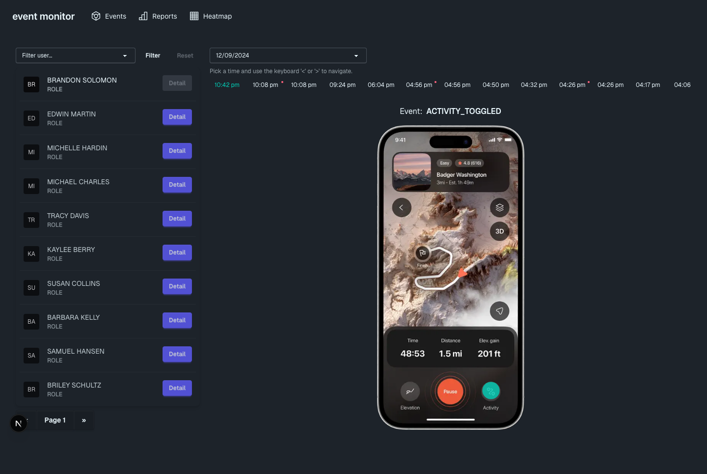

## Event monitor

A simple app to enhance visibility into user interactions



### Requirements

- Node.js v24+
- [nvm](https://github.com/nvm-sh/nvm#install--update-script) installed to manage node versions 
- [pnpm](https://pnpm.io) (npm install -g pnpm) 

## Getting Started

Set the node version and install dependencies

```sh
nvm use
pnpm install
```

Run the project

```sh
pnpm dev
```

## Notes

The current sqlite implementation is just for demo purposes. Feel free to make any required adjusments to your scenario.
